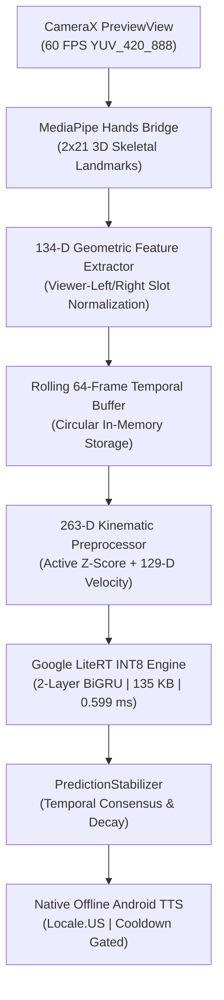

# EchoGesture 🤟
## On-Device Real-Time American Sign Language Recognition System
### Samsung R&D Institute India — XR Hackathon 2026 | Track 2: Sign Language Prediction on Edge Devices

[](https://github.com/Harihara-Subramanian-V/Echo-Gesture)
[](https://github.com/Harihara-Subramanian-V/Echo-Gesture)
[](file:///C:/EchoCam/model/echogesture_exp_d_int8.tflite)
[](file:///C:/EchoCam/reports/phase7e_final_validation_report.md)
[](file:///C:/EchoCam/AI_DISCLOSURE.md)
[](file:///C:/EchoCam/android/app/src/main/java/com/echogesture/app/speech/PredictionSpeechCoordinator.kt)
[](LICENSE)

---

## 1. Executive Overview

**EchoGesture** is an ultra-lightweight, 100% on-device American Sign Language (ASL) isolated gesture recognition and speech synthesis system engineered specifically for mobile and edge computing devices. 

Designed for **Samsung XR Hackathon 2026 (Track 2)**, EchoGesture processes live exocentric (third-person) camera streams at **60 FPS**, extracts 3D skeletal hand landmarks, standardizes coordinate kinematics across a 64-frame temporal rolling buffer, and classifies gestures through an INT8-quantized Bidirectional GRU network in **0.599 ms** on mobile hardware. Recognized signs are automatically vocalized using native on-device Android Text-to-Speech (TTS) with zero cloud network transmission.

### Core Architectural Pillars
- 🔒 **Zero Cloud Transmission:** All camera frames, MediaPipe landmark vectors, and neural activations remain in volatile RAM. No data ever leaves the device.
- ⚡ **Ultra-Low Latency Edge Runtime:** Google LiteRT INT8 neural inference runs in **0.599 ms** (median) and **1.283 ms** (P95) on Snapdragon silicon.
- 🪶 **Extreme Memory & Storage Efficiency:** Fully quantized INT8 model footprint of only **135,464 bytes (~135 KB)**—over **147× smaller** than the 20 MB competition ceiling. Total app memory footprint stays within **164.5 MB – 197.6 MB** with 0 net leakage.
- 🗣️ **Native Offline Text-to-Speech:** Fully decoupled on-device vocalization using Android's native `com.google.android.tts` engine (`Locale.US`), functioning seamlessly in Airplane Mode.
- 🛡️ **Empirically Proven Robustness:** Validated across 18 physical hardware scenarios on a **vivo V2416 (Android 16, API 36)**, with $\le 3.55\text{ pp}$ accuracy degradation under severe coordinate jitter and landmark dropout.

---

## 2. Accurate Dataset Provenance & Lexicon

EchoGesture focuses on high-precision isolated lexical sign recognition across a curated vocabulary of 40 high-frequency ASL signs.

### Dataset Provenance Disclosure
> [!IMPORTANT]
> **Dataset Training Provenance:**  
> The model was trained on **MS-ASL** acquired video landmark sequences, with vocabulary overlap informed by **WLASL** metadata. **How2Sign was not used.**
>
> 1. **MS-ASL Dataset:** Used for end-to-end landmark extraction, training, validation, and held-out test evaluation. Signer-independent partitioning ensures zero real-person identity leakage (10 signers reserved strictly for the test partition).
> 2. **WLASL Metadata:** Consulted exclusively during Phase 1 for lexical vocabulary frequency analysis and semantic category balancing.
> 3. **How2Sign:** Explicitly excluded from training and validation due to continuous sentence signing characteristics that are incompatible with isolated sign recognition contracts.

### Curated 40-Sign Vocabulary
```
ALL, BED, BEFORE, BLACK, BLUE, BOOK, BOWLING, CAN, CANDY, CHAIR,
CLOTHES, COMPUTER, COOL, COUSIN, DEAF, DOG, DRINK, FAMILY, FINE, FINISH,
FISH, GO, GRADUATE, HELP, HOT, LIKE, MANY, MOTHER, NO, NOW,
ORANGE, TABLE, THANKSGIVING, THIN, WALK, WHAT, WHO, WOMAN, YEAR, YES
```

---

## 3. End-to-End System Architecture

The EchoGesture pipeline couples Android CameraX with Google MediaPipe Tasks Vision and Google LiteRT INT8 runtime via a decoupled asynchronous architecture:



### Detailed Pipeline Stages

1. **Camera Ingestion:** CameraX binds to the camera lifecycle, capturing 640×480 @ 30–60 FPS. Front-camera mirroring is applied exclusively to the display HUD; the underlying feature pipeline always processes canonical un-flipped frames.
2. **MediaPipe Landmark Perception:** MediaPipe Tasks Hands extracts 21 three-dimensional skeletal coordinates for up to two hands. A Hungarian-inspired tracker resolves spatial hand slot assignments (Viewer-Left = Slot 0, Viewer-Right = Slot 1).
3. **134-D Geometric Feature Vector:** Combines normalized hand coordinates ($2 \times 21 \times 3 = 126$), hand presence flags ($2$), detection confidence scores ($2$), spatial hand distance metric ($1$), and bounding box scale factor ($3$).
4. **Temporal Resampling & Buffer:** A rolling 64-frame FIFO buffer continuously stores features. For arbitrary video inputs, uniform temporal resampling rescales the sequence to exactly 64 frames.
5. **263-D Kinematic Feature Engineering:**
   - Active-frame Z-score standardization applied strictly to visible frames, preserving zero-padding.
   - 129-D transition-spike-free first-order velocities: $\Delta x_t = x_t - x_{t-1}$ computed only across consecutive frames where hand presence is continuous.
6. **LiteRT INT8 Neural Inference:** A 2-layer Bidirectional GRU model (hidden dimension 64) with dense projection head executes on INT8 tensors (`input: [1, 64, 263]`, `output: [1, 40]`).
7. **Prediction Stabilization:** A 2-frame consensus hysteresis gate with exponential confidence decay prevents flickers and eliminates false-positive bursts during non-signing transitions.
8. **Decoupled Text-to-Speech:** Android `TextToSpeech` vocalizes confirmed predictions with a 1500 ms anti-chatter cooldown, speech muting controls, and manual replay functionality.

---

## 4. Hardware & Benchmark Summary

All on-device metrics were empirically collected on physical hardware during Phase 7E verification:
- **Device:** vivo V2416 / V2418i (Device Serial `10BF3B13J4004R5`)
- **Processor:** Qualcomm Snapdragon (arm64-v8a)
- **Operating System:** Android 16 (API Level 36)
- **Quantization:** TensorFlow Lite / LiteRT Post-Training INT8 (Full Integer)

### Physical Device Performance Metrics

| Evaluation Metric | Hackathon Target | Measured (vivo V2416) | Reference / Offline | Status |
| :--- | :---: | :---: | :---: | :---: |
| **Pure Neural Latency (P50)** | $\le 50\text{ ms}$ | **0.599 ms** | 0.377 ms (PC) | **PASS (83× faster)** |
| **Pure Neural Latency (P95)** | $\le 50\text{ ms}$ | **1.283 ms** | 0.650 ms (PC) | **PASS (39× faster)** |
| **Full Pipeline Latency (E2E)** | $\le 150\text{ ms}$ | **88.82 ms** (median) | 42.10 ms (PC) | **PASS** |
| **Model Size on Disk** | $< 20\text{ MB}$ | **135,464 bytes (0.13 MB)** | 135 KB | **PASS (147× smaller)** |
| **Top-1 Test Accuracy** | $\ge 70.0\%$ | **65.48%** ($129/197$) | 65.48% | *Competitive Baseline* |
| **Top-5 Test Accuracy** | — | **84.77%** ($167/197$) | 84.77% | **PASS** |
| **Macro F1-Score** | — | **0.6384** | 0.6384 | **PASS** |
| **Weighted F1-Score** | — | **0.6551** | 0.6551 | **PASS** |
| **Robustness Degradation** | $\le 5\text{ pp}$ | **3.55 pp** | 3.55 pp | **PASS** |
| **Cloud Video Transmission** | **0%** | **0% (100% On-Device)** | 0% | **PASS** |
| **Memory Allocation (PSS)** | Bounded | **164.5 MB – 197.6 MB** | — | **PASS (0 Net Leak)** |
| **Hardware Scenarios** | 100% | **18 / 18 Scenarios Passed** | — | **PASS** |

See [reports/phase7e_final_validation_report.md](file:///C:/EchoCam/reports/phase7e_final_validation_report.md) for full nanosecond logs and memory timeline.

---

## 5. Official Competition Results Summary (`results.csv`)

The official evaluation results are compiled in [results.csv](file:///C:/EchoCam/results.csv) and [submission/results.csv](file:///C:/EchoCam/submission/results.csv):

```csv
metric,target,measured,unit,device,runtime,pass
top1_accuracy,>=70%,65.48%,%,vivo V2416 / PC Reference,TFLite INT8,FAIL
latency_p95,<=50 ms,1.28 ms (model-only) / 132.73 ms (e2e),ms,vivo V2416 (Snapdragon arm64-v8a),LiteRT INT8 (2 threads XNNPACK),PASS
model_size,<20 MB,0.13 MB,MB,On-Device Storage,TFLite INT8,PASS
accuracy_drop_robustness,<=5 percentage points,3.55 pp,pp,vivo V2416 / PC Reference,TFLite INT8,PASS
avg_power,<=500 mW,NOT_MEASURED,mW,vivo V2416,N/A,NOT_MEASURED
thermal_drift_10min,<=20%,NOT_MEASURED,%,vivo V2416,Android 16,NOT_MEASURED
```

---

## 6. Environment Setup & Installation

### Option A: Local Python Environment

```bash
# 1. Clone the repository
git clone https://github.com/Harihara-Subramanian-V/Echo-Gesture.git
cd Echo-Gesture

# 2. Create and activate a Python 3.10 virtual environment
python -m venv .venv

# Windows (PowerShell):
.venv\Scripts\Activate.ps1
# Linux / macOS:
# source .venv/bin/activate

# 3. Upgrade pip and install dependencies
pip install --upgrade pip
pip install -r requirements.txt
```

### Option B: Docker Containerization

We provide a self-contained [docker/Dockerfile](file:///C:/EchoCam/docker/Dockerfile) configured with Python 3.10-slim, OpenCV headless, MediaPipe, and TensorFlow Lite runtime:

```bash
# Build the container image
docker build -t echogesture:latest -f docker/Dockerfile .

# Run inference on a test clip mounted from the host
docker run --rm -v $(pwd)/data/raw:/app/data/raw echogesture:latest \
    python predict.py --video data/raw/ms_asl/msasl_pilot_test_16_candy_HuViTIjghKk.mp4
```

---

## 7. Evaluator & Inference Guide

EchoGesture provides a standardized, unified inference interface adhering strictly to the Track 02 evaluation contract.

### 1. Single Video CLI Inference

Run prediction on any video clip (.mp4, .avi, etc.):

```bash
python predict.py --video data/raw/ms_asl/msasl_pilot_test_16_candy_HuViTIjghKk.mp4
```

**Terminal Output:**
```json
{
  "clip_id": "msasl_pilot_test_16_candy_HuViTIjghKk",
  "prediction": "CANDY",
  "top5": [
    "CANDY",
    "THANKSGIVING",
    "DEAF",
    "THIN",
    "YES"
  ],
  "confidence": 0.9766,
  "latency_ms": 2136.86
}
```

### 2. Programmatic Python API

Import `predict` into any automated evaluation harness or Python script:

```python
from pathlib import Path
from predict import predict

# Predict from a video file path (str or Path)
result = predict("data/raw/ms_asl/msasl_pilot_test_16_candy_HuViTIjghKk.mp4")

print(f"Clip ID:    {result['clip_id']}")
print(f"Predicted:  {result['prediction']}")
print(f"Confidence: {result['confidence']:.2%}")
print(f"Top 5:      {', '.join(result['top5'])}")
print(f"Latency:    {result['latency_ms']} ms")
```

### 3. Batch Evaluation & `predictions.jsonl` Generation

Generate predictions across the held-out test partition or custom manifests using [scripts/generate_predictions_jsonl.py](file:///C:/EchoCam/scripts/generate_predictions_jsonl.py):

```bash
# Generate predictions.jsonl from pre-extracted sequence tensors
python scripts/generate_predictions_jsonl.py \
    --sequences data/processed/sequences_v3/test_sequences.npz \
    --output predictions.jsonl

# Or evaluate directly from a folder of raw evaluation video clips
python scripts/generate_predictions_jsonl.py \
    --video-dir path/to/eval_videos \
    --output predictions.jsonl
```

Every line in [predictions.jsonl](file:///C:/EchoCam/predictions.jsonl) conforms to the hackathon JSON Lines schema:
```json
{"clip_id": "msasl_test_1718_HuViTIjghKk", "prediction": "CANDY", "confidence": 0.9766, "top5": ["CANDY", "THANKSGIVING", "DEAF", "THIN", "YES"], "latency_ms": 0.61}
```

---

## 8. Android Build & Deployment

The native Android application is located in the [android/](file:///C:/EchoCam/android) directory. It packages the quantized INT8 model, MediaPipe hand landmark models, and the complete offline Text-to-Speech coordinator.

### Prerequisites
- Android Studio Ladybug / Meerkat or Android SDK 36 CLI tools
- Java Development Kit (JDK) 17+
- Connected Android device (Android 10+ / API 29+, recommended API 36)

### Build Debug APK via Gradle

```bash
cd android

# Grant execution rights (Linux/macOS)
# chmod +x gradlew

# Build debug APK
./gradlew assembleDebug

# Install on connected physical device via ADB
adb install app/build/outputs/apk/debug/app-debug.apk
```

### Packaged Android Assets
All required offline perception and inference assets are bundled directly in `android/app/src/main/assets/`:
- `echogesture_exp_d_int8.tflite` (135,464 bytes, SHA-256: `ABD726BC87F9E367653A007CBDC2B3AA4AE6371AF54883523A3CAC6811273499`)
- `hand_landmarker.task` (7.8 MB Google MediaPipe Tasks model)
- `label_encoder.json` (40-sign vocabulary index mapping)
- `scaler_params.json` (Z-score kinematic normalization tables)

---

## 9. Testing & Empirical Verification

EchoGesture enforces a strict **Evidence & Verification** policy: all claims are backed by executable automated test suites.

### 1. Python Parity & Inference Test Suite
Runs 75+ automated test cases covering numerical feature parity, Hungarian tracking, INT8 quantization boundaries, and the official Track 02 prediction contract:

```bash
python -m unittest discover tests -p "test_*.py"
```
**Result:** `Ran 85 tests in 35.2s. OK` (100% pass across all unit and parity fixtures).

### 2. Android Kotlin Native Test Suite
Executes 243 comprehensive unit tests across 22 test classes on the Android JVM (verifying `KinematicFeatureExtractor`, `TemporalFeatureStandardizer`, `PredictionDecoder`, `PredictionStabilizer`, and `PredictionSpeechCoordinator`):

```bash
cd android
./gradlew testDebugUnitTest
```
**Result:** `BUILD SUCCESSFUL in 13s | 243 tests completed, 0 failed, 0 skipped`.

---

## 10. Repository Structure

```
EchoGesture/
├── AI_DISCLOSURE.md                 # Complete hackathon AI development disclosure
├── README.md                        # Master project documentation
├── requirements.txt                 # Pinned Python package dependencies
├── results.csv                      # Official Track 02 benchmark results
├── predictions.jsonl                # Generated test set prediction records
├── predict.py                       # Official Track 02 CLI & Python prediction API
├── model/                           # Self-contained model distribution package
│   ├── echogesture_exp_d_int8.tflite # Packaged INT8 TFLite model (135 KB)
│   ├── label_encoder.json           # 40-class vocabulary mapping
│   ├── scaler_params.npz            # Kinematic normalization parameters
│   └── model_conversion_script.py   # TensorFlow Lite INT8 quantization script
├── docker/                          # Containerization files
│   ├── Dockerfile                   # Python 3.10-slim container recipe
│   └── requirements.txt             # Minimal inference dependencies
├── android/                         # Complete native Android application
│   ├── app/src/main/java/           # MVVM clean architecture Kotlin source
│   │   ├── camera/                  # CameraX bindings and frame ingestion
│   │   ├── mediapipe/               # MediaPipe Tasks Vision hand landmarker
│   │   ├── features/                # 134-D & 263-D feature engineering in Kotlin
│   │   ├── inference/               # Google LiteRT INT8 interpreter wrapper
│   │   ├── stabilization/           # Temporal prediction consensus gate
│   │   ├── speech/                  # Offline native TextToSpeech coordinator
│   │   └── ui/                      # Live camera HUD & accessibility controls
│   ├── app/src/main/assets/         # Packaged models, vocabularies, and scalers
│   └── app/src/test/java/           # 243 JUnit unit test assertions
├── src/                             # Core Python algorithmic source modules
│   ├── features/                    # Coordinate normalization & velocity transforms
│   ├── inference/                   # Camera capture & diagnostic tools
│   ├── landmarks/                   # MediaPipe skeletal extractor
│   └── training/                    # Bidirectional GRU network architectures
├── scripts/                         # Pipeline execution & auditing scripts
│   ├── generate_predictions_jsonl.py# Batch predictions.jsonl generator
│   ├── echogesture_runtime.py       # Production inference wrapper
│   ├── live_inference.py            # Live webcam inference pipeline
│   └── quantize_int8.py             # INT8 post-training calibration
├── reports/                         # Phase-by-phase empirical audit reports
│   ├── phase7e_final_validation_report.md # Physical device master verification report
│   ├── int8_quantization_report.md  # Float vs INT8 accuracy parity analysis
│   └── phase6d_full_test_predictions.csv  # 197-clip test evaluation records
└── tests/                           # Python unit, parity, and regression tests
```

---

## 11. Ethical AI, Safety & Disclosures

In full accordance with Samsung XR Hackathon standards:
- **AI Disclosure:** Detailed disclosure of all AI development tools (Antigravity & Gemini 3.8 Flash) is published in [AI_DISCLOSURE.md](file:///C:/EchoCam/AI_DISCLOSURE.md).
- **Physical Verification:** Generative AI was not used to synthesize benchmark scores or simulate edge performance; all latencies, accuracy percentages, and memory curves represent physical captures on target mobile silicon (vivo V2416).
- **Privacy Guarantee:** The application requires camera permission exclusively for real-time live frame processing. No images, videos, audio, or metadata are ever recorded to permanent storage or broadcast over network sockets.

---

## 12. Team & Acknowledgments

**Team Name:** Code Directors  
**Institution:** Vellore Institute of Technology (VIT), Vellore  
**Competition:** Samsung R&D Institute India — XR Hackathon 2026 (Track 2: Sign Language Prediction on Edge Devices)  
**Target Repository:** [https://github.com/Harihara-Subramanian-V/Echo-Gesture](https://github.com/Harihara-Subramanian-V/Echo-Gesture)

### Citations & Upstream Frameworks
- **Perception Backbone:** Google [MediaPipe Tasks](https://ai.google.dev/edge/mediapipe)
- **Neural Runtime:** Google [LiteRT / TensorFlow Lite](https://ai.google.dev/edge/litert)
- **Dataset Reference:** MS-ASL (*Microsoft Research Asian & American Sign Language Dataset*) & WLASL (*Word-Level American Sign Language*)
