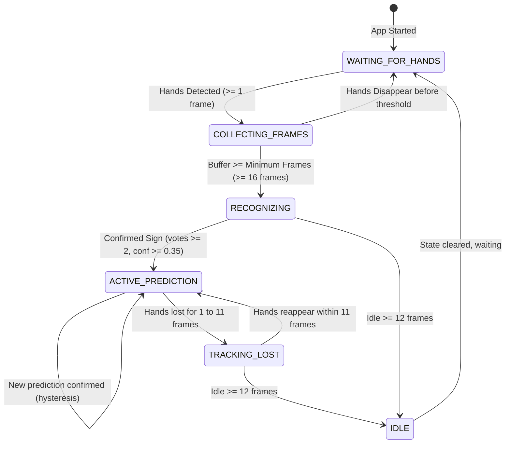

# EchoGesture Phase 7C: Real-Time Vision & Recognition Loop Architecture Plan

**Project:** EchoGesture (Track 2: Samsung XR Hackathon 2026)  
**Phase:** 7C — Real-Time Vision & Recognition Loop  
**Date:** 2026-11-20  
**Coordinator:** Gemini 3.8 Flash (High)  
**Status:** ARCHITECTURE & INTEGRATION SPECIFICATION

---

## 1. System Architecture Overview

The objective of Phase 7C is to connect the validated Android foundation and inference components into a continuous, real-time sign recognition pipeline running entirely on-device:

```
[CameraX Capture] (ImageAnalysis, KEEP_ONLY_LATEST, 640x480, Rear Default, Unflipped)
         │
         ▼ (ImageProxy -> MPImage)
[MediaPipe HandLandmarker] (tasks-vision:0.10.20, hand_landmarker.task, max 2 hands)
         │
         ▼ (List<DetectedHandCandidate>)
[HandSlotResolver] (Viewer-Left Slot 0 / Viewer-Right Slot 1, Hungarian Matching)
         │
         ▼ (ResolvedHandSlots)
[FeatureExtractor134D] (21*3 + 21*3 + Pres + Scores + Inter-hand geometry = 134-D)
         │
         ▼ (FloatArray(134))
[LiveTemporalBuffer] (Thread-safe rolling window, capacity 64, idle detection)
         │
         ▼ (Array<FloatArray> [64, 134])
[SequencePreprocessor263D] (Resampling L=64 + Active Z-Score + 129-D Velocity = 263-D)
         │
         ▼ (FloatArray(16,832) [64, 263])
[Int8Quantizer] (S_in = 0.057940476, Z_in = 23, clamp [-128, 127])
         │
         ▼ (DirectByteBuffer(16,832))
[LiteRtModelRunner] (echogesture_exp_d_int8.tflite, LiteRT 1.4.2, 2 Threads, XNNPACK)
         │
         ▼ (DirectByteBuffer(40))
[PredictionDecoder] (S_out = 0.00390625, Z_out = -128, Top-5 Sorting)
         │
         ▼ (PredictionResult)
[PredictionStabilizer] (Hysteresis, 5-frame voting, threshold 0.35, state machine)
         │
         ▼ (RecognitionUiState)
[HUD & OverlayView] (FPS, Top-3, Confidence, Latency Breakdown, Landmark Overlay)
```

---

## 2. Component Responsibility Matrix

| Subsystem | Primary Class | Responsibility | Threading Model |
| :--- | :--- | :--- | :--- |
| **Camera Capture** | `CameraController.kt` | CameraX lifecycle, rear/front selector, 640x480 resolution, unflipped canonical frames, `ImageProxy` cleanup | Dedicated single-thread analyzer |
| **Hand Landmark Detection** | `HandLandmarkDetector.kt` | MediaPipe Tasks Vision (`hand_landmarker.task`), up to 2 hands, conversion to `DetectedHandCandidate` | Background analysis executor |
| **Slot Assignment** | `HandSlotResolver.kt` | Frozen Hungarian slot resolution (Viewer-Left Slot 0 / Viewer-Right Slot 1) | Background analysis executor |
| **Feature Extraction** | `FeatureExtractor134D.kt` | Frozen 134-D vector assembly with geometric inter-wrist distance and offset | Background analysis executor |
| **Temporal Buffer** | `LiveTemporalBuffer.kt` | Rolling 64-frame sequence management, idle reset, consecutive tracking | Synchronized / Thread-safe |
| **Preprocessing & Inference** | `EchoGestureInferenceEngine.kt` | Frozen 263-D normalization, velocity extraction, INT8 quantization, LiteRT execution, decoding | Background inference thread |
| **Prediction Stabilization** | `PredictionStabilizer.kt` | Multi-frame confidence voting, state machine, anti-flicker hysteresis, idle dropout | Background inference thread |
| **UI & Telemetry** | `MainActivity.kt` & `HandLandmarkOverlayView.kt` | Rendering camera preview, landmark skeleton overlay, prominent sign display, Top-3, latency telemetry | Android Main UI thread |

---

## 3. State Machine Specification

The live recognition state machine (`RecognitionState`) transitions as follows:



---

## 4. Work Breakdown & Parallel Agent Assignments

- **Agent 1: CameraX Frame Capture**
  - Implement `CameraController.kt` with rear camera default, 640x480 strategy, unflipped frames for analysis, and robust `ImageProxy` release in `finally`.
  - Provide `CameraControllerTest.kt`.
  - Document camera lifecycle, coordinate space, and orientation.

- **Agent 2: MediaPipe and Landmark Extraction**
  - Implement `HandLandmarkDetector.kt` using `com.google.mediapipe:tasks-vision:0.10.20` and `hand_landmarker.task`.
  - Convert `HandLandmarkerResult` to `List<DetectedHandCandidate>`.
  - Provide `HandLandmarkDetectorTest.kt`.
  - Document landmark normalization, coordinate mapping, and handedness scoring.

- **Agent 3: Temporal State and Prediction Stabilization**
  - Implement `LiveTemporalBuffer.kt` (64-frame capacity, thread-safe, idle clearing).
  - Implement `PredictionStabilizer.kt` (window=5, threshold=0.35, idle=12, uncertain=5, hysteresis, 6-state state machine).
  - Provide `LiveTemporalBufferTest.kt` and `PredictionStabilizerTest.kt`.

- **Main Agent: Integration and Application Flow**
  - Coordinate pipeline in `RecognitionPipeline.kt`.
  - Build `HandLandmarkOverlayView.kt` for visual hand skeleton rendering.
  - Refactor `MainActivity.kt` into a clean MVVM HUD.
  - Run all Android and Python unit tests.
  - Perform live physical device deployment and benchmarking on `vivo V2416 (V2418i)`.
  - Generate reports and commit checkpoint.
